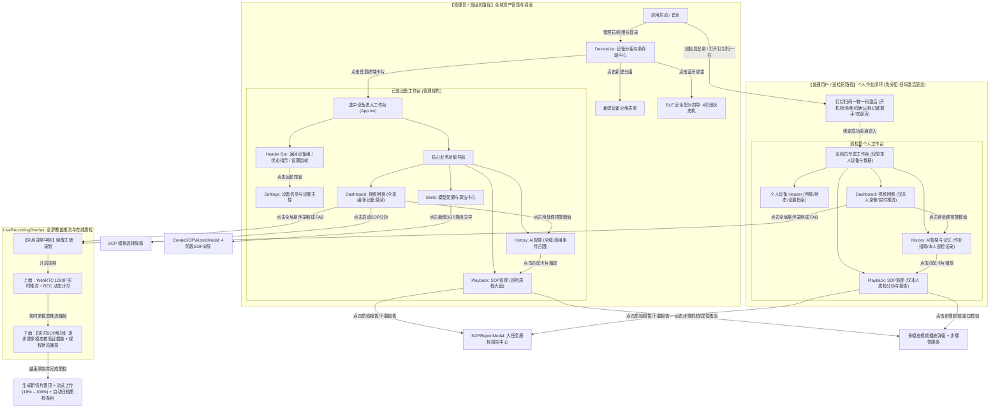
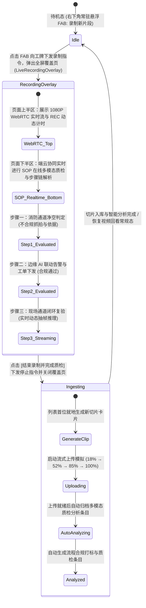
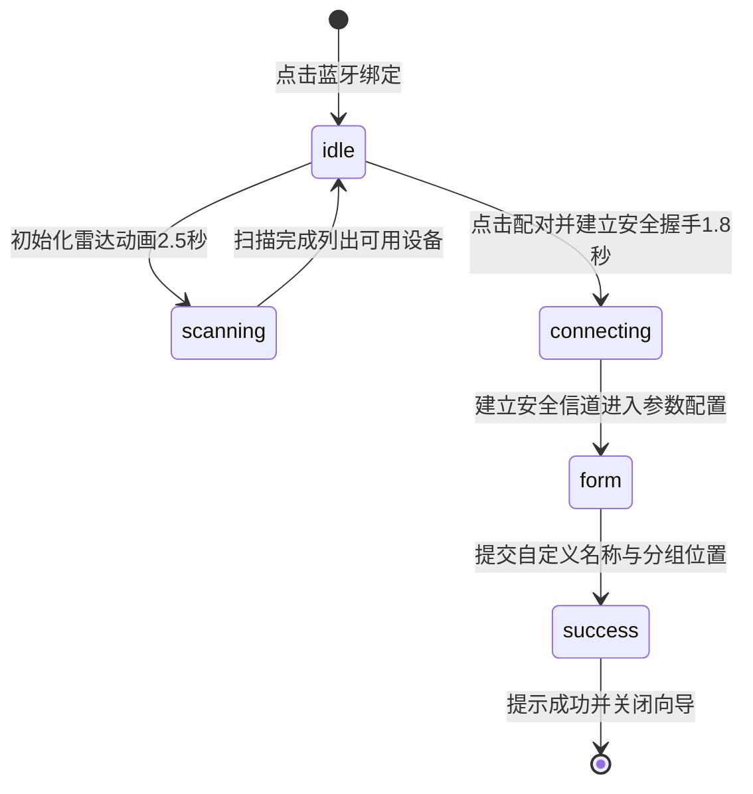
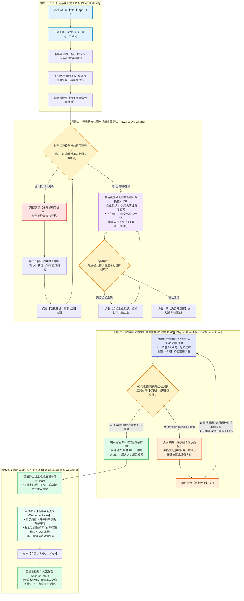

# AuraVision OS (AI 3.5) - 工业第一视角穿戴微型终端与 SOP 自动化多模态核验系统
## 全景深度产品需求文档 (PRD)

---

## 1. 文档概述与版本历史 (Document Metadata)

| 版本号 | 更新日期 | 编写人 | 评审状态 | 变更摘要 |
| :--- | :--- | :--- | :--- | :--- |
| **v3.5.0-Release** | 2026-08-19 | 产品与系统架构组 | 正式归档 | 根据最新代码重构全局布局：梳理四大主导航功能（视频回放、SOP监督、AI智搜、模型配置）、SOP步骤时间轴悬浮里程碑、SOP 4阶段创建向导、本地视频在线调试与人工核验、待处理预警归因看板及独立 HTML 质检报告系统。 |
| **v3.6.0-Release** | 2026-09-04 | 产品与系统架构组 | 正式归档 | 1. **双轨架构拓扑升级**：补充普通用户/巡检员直通路径（免设备分组，激活直接直通本人回看、SOP与AI记忆），明确管理员/班组长与巡检员路径分流；2. **全屏录制与实时SOP解析**：点击录制新片段弹出覆盖页，上方展示 WebRTC 实时流与 REC 计时，下方实时流式呈现 SOP 多模态核验逐步骤证据链；3. **企业级 RBAC 权限体系**：新增三级角色定义（组织管理员、班组管理员、巡检员）及 7 大核心功能模块细粒度权限划分矩阵。 |
| **v3.7.0-Draft** | 2026-09-16 | 产品与系统架构组 | 评审中 | **钉钉扫码激活与个人账号绑定体系**：新增基于“一物一码”扫码激活全流程规范，含设备开机状态自动检测与引导、所在企业/组织确认、工牌右侧物理“标记”按键近场防误连握手（60秒倒计时）、超时原地重试闭环（免重新扫码）及绑定成功欢迎页直通机制。 |


---

## 2. 产品概述与设计哲学 (Product Overview & Philosophy)

### 2.1 业务痛点与行业背景
在电力输配、离散精密制造、特种化工巡检以及大型集约化餐饮后厨等严苛作业现场，一线员工对标准作业程序 (SOP) 的执行准确度直接决定了作业安全与生产品质。传统安全监督体系面临三大瓶颈：
1. **固定视角盲区多**：固定监控摄像头易受人体与管道遮挡，无法捕捉第一视角 (First-Person View, FPV) 精细手部动作与仪表读数。
2. **人工抽检效率极低**：依赖安全员事后拖拽长视频进行抽检，不仅耗时耗力，且存在极高漏判率。
3. **传统 AR 穿戴设备过重**：传统带屏 AR 眼镜重量常超 300g，发热严重、续航短，且作业员双手被工具占用时分心操作屏幕极易引发触电或坠落事故。

### 2.2 核心设计哲学
本系统依托 **“物理无屏、零端侧算力、流式全自动传输、云端/边缘多模态大模型实时审计”** 的设计哲学：
* **物理无屏与轻量化 (<50g)**：终端硬件舍弃显示屏与复杂交互键，仅保留必要的状态指示灯与电源开关，实现极致轻便、长续航与高防爆等级。
* **零端侧算力与全时透传**：端侧芯片仅负责低功耗音视频编码与 5G/Wi-Fi 网络通信，不承载大模型推理；全部音视频流全时透传至企业私有云或边缘智能网关进行大模型推理。
* **无感存储循环与自动释放**：终端捕获的视频片段在上传云端并接收到完整性校验确认后，本地冷数据自动物理擦除，存储空间常年保持健康水位，免去作业员手动格式化或备份的负担。
* **从“录像粗看”到“结构化多模态记忆回溯”**：将长视频流解构为时间轴上的多模态节点与 SOP 步骤链，结合 AI 智搜实现自然语言精准秒级定位。

---

## 3. 全局架构、角色权限与视图状态机 (System Architecture, RBAC & State Machine)

### 3.1 页面层级与双轨导航拓扑架构 (Page Hierarchy & Dual-Track Navigation)
系统采用角色自适应的移动端优先架构，分为 **“管理员/班组长路径 (设备分组与多终端总览)”** 与 **“普通用户/巡检员路径 (免分组·终端激活即直通个人作业)”** 双轨拓扑：



### 3.2 角色定位与职责边界定义 (RBAC Role Definitions)

系统根据工业与现场生产管理层级，设定清晰的三级权限模型：

| 角色名称 | 典型岗位代表 | 核心定位与业务职责 | 权限范围 |
| :--- | :--- | :--- | :--- |
| **组织管理员** | 企业安全总监 / IT与设备部主管 / 安全合规总监 | **全局资产管控与标准制定者**：负责全公司/全厂区设备资产管理、企业级 SOP 标准规程库审核与发布、AI 额度充值分配、全局模型算法库维护及跨部门审计报告归档。 | **全局最高权限**<br>全厂区跨班组可见、全局配置可写 |
| **班组管理员** | 巡检班长 / 车间安全员 / 厨师长 / 现场工段长 | **现场作业监督与调度处置者**：负责本班组设备领用分配、现场 WebRTC 实时流抽查与远程录制发起、SOP 违规事件闭环确认与复核、本班组 SOP 质检报告下载与日报审查。 | **班组级管理权限**<br>限本班组管辖设备与人员，具备运行、指派与复核权 |
| **巡检员** | 高压电工 / 后厨操作员 / 巡检安保 / 产线装配工 | **现场第一视角作业执行者**：佩戴轻量微型终端进行现场巡检与标准化作业，执行工牌本地按键唤醒/录制、接收工牌震动/语音违规提示、查看个人工单与任务指南，SOP 质检报告下载与日报审查。 | **个人级受限权限**<br>仅限本人佩戴设备、本人任务与教程指南 |

### 3.3 细粒度功能模块权限划分矩阵 (Functional Permissions Matrix)

| 一级功能 | 二级功能 | 功能名称 | 详细功能说明 | 组织管理员 | 班组管理员 | 巡检员 |
| :--- | :--- | :--- | :--- | :---: | :---: | :---: |
| **设备资产与连接管理** | 资产大盘与分组 | 跨区域资产总览 | 查看全厂区/各车间工牌在线、离线、电量及预警状态 | 完全控制 | 限本班组 | 无权限 |
| | | 新建/编辑设备分组 | 创建车间/班组分组，跨部门批量划拨与调整设备归属 | 完全控制 | 无权限 | 无权限 |
| | | 设备模糊检索筛选 | 支持按设备名称、型号、责任人、物理部署位置实时检索 | 全局检索 | 限本班组 | 无权限 |
| | | 基础信息与人员配置 | 修改工牌设备名称、挂载区域、佩戴责任人与工号绑定 | 完全控制 | 限本班组 | 无权限 |
| | 设备绑定 | BLE 蓝牙扫描发现 | 通过 BLE 近场低功耗蓝牙扫描周围待配对新工牌终端 | 完全控制 | 可配对新机 | 无权限 |
| | | 钉钉扫码一物一码激活 | 钉钉扫码识别设备SN，检测开机、确认组织与物理按键配对绑定账号 | 允许激活 | 允许激活 | 允许激活 (直通工作台) |
| | 工作台设备列表 | 设备工作台进入切换 | 点击设备卡片进入对应的视频回放、SOP 监督与控制台 | 任意切换 | 限本班组 | 无权限 |
| **视频回放与实时流监控** | 双模视频流视口 | WebRTC 实时流 | 调阅当前作业员第一视角 1080P 60FPS 低延迟推流画面 | 任意抽查 | 限本班组 | 仅本人设备 |
| | | 录像播放 | 回放按小时分卷 MP4 录像，支持时间轴拖拽与全屏 | 全部回放 | 限本班组 | 仅本人录像 |
| | 工牌远程控制 | 启动录制 | 通过 App 远程向工牌下发录制新视频指令，展开 REC 计时 | 允许控制 | 允许控制 | 允许控制 |
| | | 结束录制 | 停止录制并在列表首位即时生成录像切片，开启流式上传 | 允许控制 | 允许控制 | 允许控制 |
| | 录像分卷管理 | 按小时分卷浏览切换 | 按小时分卷卡片式呈现录像，支持网格 (Grid)/列表 (List) 切换 | 全部浏览 | 限本班组 | 仅本人切片 |
| | | 原始视频片段导出 | 一键下载当前选中的原始分卷 MP4 视频文件至本地 | 允许导出 | 限本班组 | 无权限 |
| | 视频 SOP 分析 | 单片段发起 SOP 分析 | 针对指定视频片段唤起 SOP 模板选择弹窗并启动大模型分析 | 允许触发 | 允许触发 | 允许触发 |
| | | 分析过程状态指示 | 播放器下方实时展示提取关键帧、模型比对、合规打标进度条 | 仅查看 | 仅查看 | 仅查看 |
| **SOP 监督与全流程核验** | 预警看板与归因 | 待处理预警事件看板 | 置顶 Bento 看板：严重违规 P0、中度偏离 P1、建议 P2 | 全局大盘 | 班组大盘 | 仅本人预警 |
| | | 预警卡片穿透联动 | 点击预警指标卡片，携带对应 Query 自动跳转 AI 智搜归因 | 允许穿透 | 允许穿透 | 允许穿透 |
| | 视频聚合概览 | 单视频多 SOP 聚合列表 | 按原始视频聚合展示其执行的全部 SOP 规程条目与合规状态 | 全部可见 | 本班组可见 | 仅本人可见 |
| | 逐步骤核验详情 | 中文序号里程碑轴线 | 穿透展示纵向时间轴、悬浮中文序号圆点（步骤一~四） | 全部可见 | 本班组可见 | 仅本人可见 |
| | | 规程标准与 AI 证据比对 | 步骤卡片结构化比对 SOP 标准规范与大模型视觉核验证据 | 全部可见 | 本班组可见 | 仅本人可见 |
| | | 现场抓拍与秒级快跳 | 展示步骤关键帧抓拍，点击自动快跳对齐视频对应动作秒数 | 允许快跳 | 允许快跳 | 仅本人录像 |
| | 质检报告入口 | 报告下载中心唤起 | 点击“下载质检报告”快捷唤起大任务质检报告中心弹窗 | 允许唤起 | 允许唤起 | 允许唤起 |
| **AI 智搜** | 多模态智能搜索 | 自然语言与语音提问 | 支持文字输入或语音提问（如“配电房接地线是否挂牌”） | 全域检索 | 限本班组 | 仅作业指南 |
| | | 快捷智能查询卡片 | 点击常用提问推荐卡片一键发起典型隐患与作业规范检索 | 允许使用 | 允许使用 | 允许使用 |
| | 图文召回与联动 | 关键帧展示 | 召回现场第一视角关键帧图片、发生时间戳与详细核验结论 | 全部可见 | 本班组可见 | 仅本人可见 |
| | | 一键联动 SOP 监督定位 | 点击卡片一键直达 SOP 监督页面对应步骤时间轴并同步播放 | 允许联动 | 允许联动 | 仅本人录像 |
| **模型配置与算法中心** | 行业模型库管理 | 行业算法库浏览与分类 | 按电力、食安、安保、制造分类浏览专属视觉/语音推理大模型 | 完全控制 | 仅查看 | 无权限 |
| | | 硬件算法包 Toggle 开关 | 切换模型激活开关，将指定 AI 算法包下发绑定至在网硬件 | 全局开关 | 限本班组 | 无权限 |
| | AI 问答推荐 | 业务痛点智能诊断 | 自然语言描述现场痛点，AI Copilot 智能诊断匹配算法组合 | 允许使用 | 允许使用 | 无权限 |
| | | 推荐模型组合一键部署 | 一键批量分发模型密钥并向指定终端更新在网算法激活状态 | 全局部署 | 部署本班组 | 无权限 |
| | 特殊物品 AI 标记 | 特种工具画框标注 | 上传抓拍图，通过 Bounding Box 画框标注专用工具与特征 | 审批发布 | 提交标记 | 无权限 |
| | | 误判说明与特征对齐 | 录入误判原因与文字特征说明，沉淀至微调特征对齐库 | 审批发布 | 提交标记 | 无权限 |
| **SOP 规则向导与编排下发** | 基础信息配置 | 规程基础参数配置 | 输入 SOP 名称、行业类别、上限时长滑块与功能备注 | 允许配置 | 允许配置 | 无权限 |
| | 步骤链编排 | 步骤增删与顺序调整 | 动态添加步骤链卡片，支持上移、下移排序与单步删除 | 允许编排 | 允许编排 | 无权限 |
| | 视频在线调试 | 本地视频上传与播放仿真试运行 | 上传本地示范视频，进行动作预览调用推理模拟器输出综合得分、推理延迟及逐步骤检测 | 允许调试 | 允许调试 | 无权限 |
| | 设备组绑定 | 终端检索与全选多选 | 在终端列表中搜索、全选或勾选需要下发该 SOP 的硬件终端 | 跨组选择 | 仅本组终端 | 无权限 |
| **设备系统设置与运维主控** | 硬件参数调节 | 播报音量滑动调节 | 调节终端播报音量（0~100%），支持静音与数值联动 | 允许调节 | 允许调节 | 仅本人设备 |
| | | AI 安全核验额度大盘 | SVG 环形仪表盘展示月度剩余推理次数，支持额度同步与充值 | 充值与分配 | 仅看配额 | 无权限 |
| | 固件与指南 | 固件远程 OTA 升级 | 检查新版本固件、下载固件包、A/B 双分区刷入与热重启 | 全局推送 | 本班组升级 | 无权限 |
| | | 使用教程与指南查阅 | 阅读《第一视角对焦指南》与《指示灯交互说明》 | 允许查阅 | 允许查阅 | 允许查阅 |

### 3.4 全局屏幕与视图状态定义 (`AppScreen` & `ViewState`)

#### 全局屏幕模式 (`AppScreen`)
| AppScreen Key | 模式名称 | 视口形态 | 核心业务职能 | 适用角色 |
| :--- | :--- | :--- | :--- | :--- |
| `super_app` | **综合工作台母体** | 移动端机型视口 (`max-w-md`) | SuperApp 框架，承载工作台 (Workbench)、首页、智能场景、我的个人中心。 | 组织管理员 / 班组管理员 |
| `badge_app` | **督察官微应用** | 移动端机型视口 (`max-w-md`) | 已选定终端专属操作台，包含 3 大核心导航（视频回看、SOP监督、AI智搜）及设备设置。 | 全角色 (按 RBAC 范围隔离数据) |
| `page_flow` | **页面跳转全景图** | 宽屏沉浸式画布 (`Full-Canvas`) | 页面流转全景图架构，完整还原页面角色标头、手机原型卡片、判定菱形分支、正交折线箭头、toast反馈与一键试玩。 | 组织管理员 / 架构与评审人员 |

#### 督察官子视图 (`ViewState`)
| ViewState Key | 导航显示名称 | 图标组件 | 核心业务职能 |
| :--- | :--- | :--- | :--- |
| `dashboard` | **视频回看** | `Film` | 设备状态卡片、顶部 SOP 待处理预警看板、**【全屏覆盖】WebRTC 1080P 实时推流 + 在线实时 SOP 多模态核验**、按小时分卷片段管理、启动 SOP 视频分析。 |
| `playback` | **SOP监督** | `BrainCircuit` | 纵向时间轴流、SOP 大任务节点、逐步骤悬浮中文序号里程碑、AI 现场核验证据比对、全屏多模态播放弹窗（含步骤快跳条）、SOP 质检报告下载。 |
| `history` | **AI智搜与记忆** | `Clock` | 自然语言多模态智能问答、SOP 待处理事件归因与责任人看板、图文结合关键帧召回、一键跳转 SOP 监督联动定位。 |
| `skills` | **模型配置** | `Layers` | 行业划分模型库、AI 智能问答组合推荐、特殊物品 AI 标记与纠错、新增 SOP 规则向导（4阶段链式编排与下发）。*(管理员专享)* |
| `settings` | **设备设置** | `Settings` | 顶部齿轮进入：硬件参数滑块调节（音量/灯光）、内部存储全时自动释放、AI 核验额度管理仪表盘、固件 OTA 远程升级、使用教程指南。 |
| `devices` | **设备管理** | `Smartphone` | 多终端分组、近场 BLE 4 阶段安全绑定配对向导。*(管理员/班组长专享)* |

### 3.5 工牌远程录制与切片生成状态机 (Remote Recording Lifecycle)


---

## 4. 各模块功能与状态流程详述 (Detailed Functional Specifications)

### 4.1 模块一：设备分组与蓝牙安全绑定 (`DeviceList.tsx`)

#### 4.1.1 业务目标
解决工业微型穿戴设备“物理无屏、无输入键盘”带来的绑定与资产分组管理难题，提供基于 BLE（蓝牙低功耗）近场安全通道的一键发现、密钥协商与分组挂载。
* **双轨角色路径分流规范**：
  * **组织管理员 / 班组管理员**：进入 `DeviceList` 设备多终端中心，负责全厂区/本班组设备池总览、新建分组、设备调配划拨与批量 BLE 配对。
  * **普通用户 / 巡检员**：登录或通过 BLE 完成本人设备配对激活后，**系统自动绕过设备分组中心，直接直通进入本人专属工作台**（仅承载个人录像回看、个人 SOP 监督核验与个人 AI 记忆智搜），杜绝跨设备冗余信息干扰。

#### 4.1.2 页面布局与交互要素
* **顶部品牌 Header**：展示 `AuraVision OS AI 3.5` 品牌标志、实时护航运行指示。
* **搜索栏**：支持按设备名称、型号、部署物理位置实时模糊检索。
* **操作按钮组**：
  * **新建分组**：唤起内联表单，输入分组名称，并在现有设备池中多选批量归属。
  * **蓝牙绑定**：唤起蓝牙设备绑定全屏向导。
* **分组级联设备卡片列表**：按区域分组展示挂载设备，包含在线/告警/离线状态指示灯、电池电量百分比、现场首帧抓拍实时预览图、告警角标。点击任意设备进入该设备工作台。

#### 4.1.3 蓝牙配对状态机 (BLE Pairing State Machine)


#### 4.1.4 核心数据结构
```typescript
export interface Device {
  id: string;
  name: string;
  status: 'online' | 'offline' | 'warning';
  battery: number;
  model: string;
  location: string;
  imageUrl?: string;
}

export interface DeviceGroup {
  id: string;
  name: string;
  devices: Device[];
}
```

---

### 4.2 模块二：视频回放与 SOP 视频分析 (`Dashboard.tsx`)

#### 4.2.1 业务目标
为管理者提供工业记录仪原始录像片段的线性浏览、精准时间回溯、分卷管理，并在顶部实时汇聚待处理预警，支持针对指定录像片段选择 SOP 规程并启动云端多模态视频质检分析。

#### 4.2.2 详细功能与组件布局
1. **全局顶部导航栏 (Global Header)**：
   * 包含返回设备组按钮、实时在线状态指示灯、当前选定设备名称、**【提至顶部】实时电池电量胶囊 (`🔋 42%`)** 与设备设置入口齿轮。
2. **双模视频视口 (WebRTC 实时流 / Linear 原始录像播放器)**：
   * **WebRTC 实时推流模式 (终端录制开启态)**：
     * **画面实时接入**：当 App 端开启录制时，视频画面无缝切换为当前硬件穿戴终端的 **1080P 60FPS WebRTC 低延迟实时流**。
     * **录制状态与计时胶囊 (Top-Left)**：浮动展示呼吸跳动的红点 `● REC` 与动态累加录制时长（如 `REC 00:15`）。
     * **实时网络遥测徽标 (Top-Right)**：展示 `WebRTC 1080P | 24ms` 低延迟链路指标与脉冲信号灯。
     * **画面准星与暗角扫描线**：叠加第一视角聚焦辅助线与极简纯净推流视野，右下角提供轻量全屏与音量微控制。
   * **Linear 原始录像播放模式 (常规回放态)**：
     * **16:9 播放视口**：加载当前选中录像分卷的 MP4 视频源与 Poster 抓拍图。
     * **动态时间戳悬浮条**：左上角实时渲染 `[设备名] (型号) | YYYY-MM-DD HH:MM:SS`，根据播放进度动态累加秒数。
     * **媒体控制工具条**：播放/暂停切换、当前播放时间/总时长、静音/取消静音、全屏切换。
     * **角标**：右下角常驻 `RAW_LINEAR_FOOTAGE` 专业分卷标识。
3. **极简单行综合控制操作栏与 SOP 规程提示条 (Unified Action Bar & SOP Info Strip)**：
   * **当前片段操作栏 (Current Clip Action Bar - 纯粹针对当前选定视频)**：
     * **日期下拉胶囊 (`< 今日 ▽ >`)**：支持快速切换今日、昨日及历史归档日期。
     * **启动/重新 SOP 分析按钮 (`✨ 启动分析` / `✨ 重新分析`)**：高亮紫色渐变按钮，点击快速唤起模板选择，支持为当前视频片段重新选择或更换 SOP 规程模板并启动多模态视频质检分析。
     * **片段下载按钮 (`↓`)**：一键导出当前选中的原始视频文件。
     * **布局切换按钮**：默认展示 **双列卡片网格 (Grid)** 模式，支持与 **单列列表 (List)** 视图无缝切换。
   * **【提示信息条】SOP 规程标签看板与直达监督按钮 (Prompt Info Bar & Supervision Entry)**：
     * 紧随操作栏下方，以轻量暗调胶囊卡片形式呈现当前视频已关联的 SOP 规程。
     * **左侧 SOP 标签展示（最多 2 行）**：展示 `[已分析 N 项 SOP]` 及当前视频已关联的 SOP 规程徽标（如 `[⚡ 高压电工SOP]`、`[🚨 消防巡检SOP]`），**最多展示两行**；若关联的 SOP 数量较多超出两行空间，自动收敛并以 `更多...` 徽标替代，点击亦可直达监督页。
     * **右侧独立「查看」跳转按钮**：右侧常驻渐变高亮 `查看 →` 快捷按钮，点击后自动携带当前视频对应的 SOP 任务 ID 直达 **「SOP 监督」** 页面，定位并展开对应 SOP 逐步骤核验流。
4. **【全屏覆盖】全局悬浮录制中枢与实时 SOP 多模态质检覆盖页 (`LiveRecordingOverlay.tsx`)**：
   * **心智模型彻底解耦**：将“远程开启录制”升级为覆盖全屏的沉浸式中枢（Live Recording Overlay），支持实时监控第一视角推流并同步查看端云大模型实时推理比对结果。
   * **待机态 (Idle State)**：右下角常驻带微光呼吸动效与录制光圈的悬浮胶囊 `[ 🔴 录制新片段 | 唤醒工牌拍摄 ]`，支持随时一键发起新拍摄任务。
   * **全屏覆盖录制态 (Active Recording Overlay State - 弹窗覆盖现有页面)**：
     * 点击触发后平滑弹出全屏新页面覆盖当前视图，包含顶部状态条（退出、设备名、实时在线绿点与电池电量）。
     * **页面上半区 (WebRTC 实时推流视口)**：
       * 16:9 视口加载硬件穿戴终端的 **1080P 60FPS WebRTC 低延迟实时流**。
       * 左上角悬浮呼吸红点与动态计时胶囊 (`● REC 00:xx`)。
       * 右上角常驻网络遥测徽标 (`WebRTC 1080P | 24ms`)。
       * 画面中心叠加第一视角对焦准星辅助 HUD，右下角提供静音/取消静音控制与快捷结束录制按钮。
     * **页面下半区 (实时 SOP 多模态质检过程 - 契合规范样式)**：
       * **规程标头**：展示 `✨ 园区消防通道 SOP`（或对应行业模板）与 `共 3 个规程核验步` 统计。
       * **连续蓝色垂线时间轴**：贯穿所有正在核验的规程步骤。
       * **步骤一 (红标 - 不合规)**：红色胶囊 `✨ 步骤一：消防通道 2.4 米净空巡检规程`、时段 `07:15:00 - 07:15:10`、`❌ SOP 校验不合规` 徽标、规程标准文字、粉色 AI 现场核验识别结果框（占用通道判定依据与实测宽度）及现场关键帧抓拍图。
       * **步骤二 (绿标 = 合规通过)**：蓝紫胶囊 `✨ 步骤二：边缘 AI 联动告警与工单自动下发`、时段 `07:15:11 - 07:15:20`、`✅ SOP 校验通过 (100%)` 徽标、规程标准、蓝色 AI 现场识别结果框（整改工单 #WO-8821 下发与喇叭播报提示）及现场抓拍图。
       * **步骤三 (黄标 三 实时核验中)**：动态实时抽帧与端云协同推理状态条（延迟 24ms、实时扫光动效），显示“保洁人员就位清障闭环复验中”。
     * **底部固定操作栏**：提供「放弃录制」与「结束录制并完成质检 (00:xx)」，点击后生成新切片插入列表首位并自动将该质检条目归档入库。
5. **正在分析的过程状态展示 (In-flight Analysis State)**：
   * 当用户启动 SOP 分析后，在播放器下方展开动态分析进度条：
     * `12%`：提取视频 60fps 第一视角关键帧与多模态音视频流。
     * `48%`：调用特定 SOP 行业大模型逐帧比对规程。
     * `82%`：计算置信度并生成流程合规打标。
     * `100%`：分析完成，弹出绿色 Toast 提示，并将分析结果无缝追加至对应录像卡片的 SOP 规程集合中。
6. **极简录像片段列表与状态呈现 (Clips Segment List & Status)**：
   * **无冗余标题栏 (Borderless Streamlined List)**：去除了列表上方的 `录制片段及时间段 / SOP状态 / 时长` 冗余表头，卡片内容自解释，界面更紧凑、沉浸。
   * **列表内不再显示已分析后的 SOP 标签**：已完成 SOP 质检分析的片段在列表中保持极简呈现，不展示重复的 SOP 徽标，统一由上方播放器提示条进行质检看板展示与跳转；未分析片段保留 `未分析` 按钮，上传中片段保留进度状态。
   * 按录制小时分组（如 `14:00`、`13:00`），实时包含 App 远程录制生成的最新片段。
   * **行高统一与防折行设计 (Uniform Row Height)**：列表模式下所有卡片均设定固定基准高度 (`min-h-[64px]`)，右侧状态栏统一固定宽度，严格采用 `whitespace-nowrap`，彻底消除不同文字长度导致的卡片高低不齐或竖向折字拉高现象。
   * **视频上传中状态呈现 (Uploading State)**：
     * **列表模式**：缩略图叠加半透明云端跳动图标与百分比，标题栏附带 `☁️ 正在上传 (xx%)` 呼吸标签与渐变进度条，右侧状态栏展示 `上传中 xx%` 旋转指示器。
     * **网格模式**：卡片边缘带有 Sky-blue 呼吸光晕，右上角高亮展示 `上传中 xx%` 徽标，底部常驻上传进度条。
     * **上传完成态**：自动过渡为 `✓ 已同步 / 待分析`，可直接启动 SOP 多模态分析。
   * 片段卡片基础要素：
     * 左上角时间标签胶囊：`[时间] [序号] [时长]`（如 `14:20 20 0'34"`）。
     * **右侧状态区域**：上传中展示 `上传中 %`；未分析展示灰色 `未分析`（点击可快捷唤起 SOP 分析）；已分析仅保留时长展示。
     * 左下角片段场景描述文字（单行截断 `truncate`）。
     * 右下角红点异常警报指示灯（带呼吸动效）与人体识别图标。
7. **SOP 模板选择弹窗 (`SOPAnalysisTemplate`)**：
   * 支持选择系统内置的四大 SOP 分析规程模板：
     * `ck`：餐饮后厨冷链生鲜与切配卫生 SOP（3 规程步）。
     * `ee`：高压电气配电柜定检及 LOTO 规程（4 规程步）。
     * `sf`：园区消防通道与周界巡检 SOP（3 规程步）。
     * `mf`：离散制造精密组装与力矩紧固 SOP（3 规程步）。
   * 具备智能推荐默认选中功能（根据片段描述关键词自动推荐匹配模版）。

---

### 4.3 模块三：SOP 监督与逐步骤全流程核验 (`Playback.tsx`)

#### 4.3.1 业务目标
彻底淘汰传统无索引长视频的盲目调阅与全天冗长铺展的时间轴，重构为**两阶段层级架构**：“顶部待处理预警事件看板” + “SOP 质检分析结果概览列表” + “点击穿透进入单一 SOP 逐步骤核验时间轴”，兼顾全天质检大局概览与微观证据链追溯。

#### 4.3.2 界面架构与关键交互
1. **【置顶常驻】SOP 待处理预警事件统计看板**：
   * **极简直出**：去除了页面顶部冗余的大标题与副标题描述，顶部首屏直接直出展示深色 Bento 预警事件统计网格，界面更具效率感与质感。包含 4 项核心统计指标：
     * **待处理总数 (Total Pending - Rose)**：如 `3 项`，点击跳转 AI 智搜检索全部未闭环事件。
     * **🔴 严重违规 (Critical Alert - Rose)**：如 `1 项`，高压未穿戴 PPE/未挂牌违规。
     * **🟡 中度偏离 (Medium Warning - Amber)**：如 `1 项`，冷链处理超时 SOP 偏离。
     * **🔵 智能建议 (Low Notice - Indigo)**：如 `1 项`，夜巡暗光隐患优化建议。
   * 点击任意统计卡片，触发 `onNavigateToSearch` 携带对应 query 自动跳转至 **AI 智搜** 视图。
2. **顶部控制栏**：
   * 日期切换器（`< 今日 ▽ >`）、**“下载质检报告 (全部 SOP)”** 独立按钮（唤起 `SOPReportModal`），去除了冗余的圆形下载按钮。
3. **视图一：SOP 质检分析结果概览列表 (SOP Analysis Results List View - 默认主视图 · 视频片段聚合架构)**：
   * **按“原始视频片段”聚合展示**：如果同一视频片段经过了多次不同 SOP 的质检分析（如 A 区配电房录像同时跑了“高压电气定检 SOP”与“园区消防通道 SOP”），系统自动在该视频片段卡片内进行聚合沉淀，彻底杜绝视频重复与列表混乱。
   * **视频聚合卡片核心要素**：
     * **顶栏**：拍摄时间点（如 `14:19:00`）、小时分卷（`14:00分卷`）、作业区域（`A区配电房 · 高压巡检录像`）及统计胶囊（`已分析 2 项 SOP`）。
     * **左侧**：高清晰第一视角抓拍缩略图（`w-24 h-18`，带秒级时长角标 `0'34"`，在多条 SOP 叠加时**自动上下居中**对齐）。
     * **右侧（聚合 SOP 条目列表）**：
       * 针对该视频片段已执行的每条 SOP，独立渲染一条交互规程项：
         * SOP 专属规程徽标（`⚡ 高压电气定检 SOP` / `🚨 园区消防通道 SOP`）。
         * 规程步骤合规胶囊（`3/4 项合规`）与微型多色指示灯（🟢🟢🔴🟢）。
         * 独立穿透入口 **`查看详情 →`**，点击即可直接切换进入该特定 SOP 的 4 步逐步骤全流程核验时间轴。
4. **视图二：SOP 详情与逐步骤全流程核验时间轴 (SOP Detail & Step Timeline View - 穿透详情)**：
   * **返回导航顶栏**：左侧提供简洁的 **`← 返回`** 快捷键，右侧常驻 **`任务质检报告`** 导出按钮。
   * **独立 SOP 规程标题行**：导航栏下方单独一行展示当前 **SOP 规程徽标**（如 `✨ 园区消防通道 SOP`）与规程步骤总数统计。
   * **去大卡片直出时间轴**：移除冗余的顶置大任务卡片与大段描述，点击穿透后直接直观展示当前 SOP 的**逐步骤核验时间轴**（步骤一至步骤四），视线无需滚动即可立刻触达关键步骤核验结果。
   * **专属逐步骤核验时间轴 (Vertical Step-by-Step Timeline)**：
     * 仅聚焦当前选定 SOP 规程的子步骤（如步骤一至步骤四），不再混杂全天其他无关节点。
     * **悬浮中文序号里程碑圆点**：直接锚定在垂直时间轴线上，使用中文数字 `一`、`二`、`三`、`四`... 标识，根据合规结果赋予不同色彩（绿色=合规，红色=违规，黄色=预警）。
     * **悬浮步骤标题药丸**：悬浮于轴线右侧，标明 `步骤一：断电隔离与 LOTO 锁扣挂牌程序` 等。
     * **步骤时间段标签**：标明精准秒级时段（如 `10:30:05 - 10:30:22 (17s)`）。
     * **步骤质检详情卡片**：
       * **合规状态 Badge**：带图标的高亮徽标，注明 `SOP 校验通过 (99.8%)` / `SOP 校验不合规` / `SOP 校验预警`。
       * **规程标准说明 (`sopStandard`)**：展示该步骤对应行业或企业规范要求。
       * **AI 现场核验识别证据 (`aiEvidence`)**：结构化展示大模型逐帧比对文字依据与违规定性。
       * **步骤现场抓拍缩略图**：展示该步骤的关键帧抓拍。
   * **底部回退按钮**：底部常驻 `← 返回全部 SOP 分析结果列表`，支持随时返回总览。

#### 4.3.3 核心数据结构 (`SOPStepItem` & `TimelineEvent`)
```typescript
export interface SOPStepItem {
  id: string;
  stepNo: number;
  title: string;
  sopStandard: string;
  aiEvidence: string;
  status: 'passed' | 'failed' | 'warning' | 'pending';
  confidence?: number;
  timeRange?: string;
  seekSeconds?: number;
  snapshotUrl?: string;
  notes?: string;
}

export interface TimelineEvent {
  id: string;
  timestamp: string;
  timeLabel: string;
  type: 'audio' | 'video' | 'context';
  summary: string;
  detail?: string;
  tags?: string[];
  imageUrl?: string;
  audioDuration?: string;
  sopId?: string;
  sopName?: string;
  sopScore?: number;
  sopOverallStatus?: 'passed' | 'failed' | 'warning';
  steps?: SOPStepItem[];
}
```

---

### 4.4 模块四：AI 智搜与多模态知识图谱 (`History.tsx`)

#### 4.4.1 业务目标
基于大语言模型语义向量与多模态知识图谱，允许管理者使用自然语言或语音提问，对历史作业记录、未闭环隐患、特定人员违规进行即时归因与关键帧调阅。

#### 4.4.2 界面交互与智能问答流
1. **智能输入框**：支持多行文字与语音提问，具备 Sparkles 呼吸动效与自动滚动对齐。
2. **推荐智能查询卡片**：在初始未搜索状态下提供常用快捷提问（如“消防通道违规整改了吗？”、“配电房安全定检记录”、“A区后厨食材备菜核验”）。
3. **AI Copilot 智能问答与事件归因**：
   * 结构化解析提问意图，自动归纳出包含 **责任人 (工牌 ID)**、**发生时间**、**物理空间位置**、**目前处置状态 (待现场处置 / 待主管签发 / 待远程加载)** 的事件看板。
4. **图文结合关键帧召回 (Matched Keyframes Bento Cards)**：
   * 召回卡片展示现场第一视角抓拍图像、时间戳、详细核验结论。
   * **一键跳转联动**：卡片底部配有 **“一键跳转SOP监督并播放录像”** 按钮。点击后系统自动切换至底栏 `playback` 视图，并将主时间轴与播放器高亮定位至对应事件，实现闭环跳转。

---

### 4.5 模块五：模型配置与算法中心 (`Skills.tsx`)

#### 4.5.1 业务目标
为企业提供行业大模型算法包的管理、AI 问答诊断推荐、特殊物品微调标记，以及唤起 4 阶段 SOP 规则创建向导。

#### 4.5.2 三大专用模式切换器 (3 Mode Tabs)
1. **模式 1：行业划分库配置 (Manual Tab)**：
   * **按行业深度匹配导航**：全部模型、餐饮与食品安全、高危电力与重工、园区与仓储物流、制造与运维协同。
   * **算法卡片矩阵**：展示算法包名称、类别标签（安全合规 / SOP标准化 / 日常维保）、业务说明、建议开启徽标、硬件激活开关 Toggle。
2. **模式 2：AI 智能问答推荐 (AI Tab)**：
   * **Copilot 智能诊断**：管理者以自然语言描述现场痛点（如“我是连锁面馆，怕后厨着火和生熟混用”）。
   * **知识图谱关联与方案出具**：AI 自动诊断并匹配推荐模型组合（如 `s1 + s5`）。
   * **一键部署机制**：点击“一键部署并激活推荐模型”，系统模拟密钥分发与模型下发，实时更新在网终端算法状态。
3. **模式 3：特殊物品 AI 标记与纠错 (Objects Tab)**：
   * **业务痛点**：现场特种工具（如防静电绝缘钳、生熟色标双刀架）常被通用大模型误判。
   * **新增标记表单**：支持输入物品名称、误判原因与文字特征说明、截图画框标注标签。
   * **标记对齐卡片**：展示现场抓拍图上覆盖的动态 **Bounding Box (标注框)**、特征对齐标签与文字说明，用于模型微调与特征对齐。

---

### 4.6 模块六：SOP 规则链式编排向导 (`CreateSOPWizardModal.tsx`)

#### 4.6.1 业务目标
为企业安全主管提供标准化的 SOP 新增流程，通过 4 阶段链式向导实现“基础信息 -> 步骤链编排 -> 本地视频在线调试与人工核验 -> 终端策略下发”。


#### 4.6.2 四阶段详细交互设计
1. **阶段 1：基础信息配置 (Basic Info)**：
   * 输入 SOP 规程名称、选择行业领域、拖动流程上限时长滑块 (1-60 分钟)、输入场景功能备注。
   * 支持从预设模板（空白模板、高危电工、餐饮后厨、精密装配）一键导入初始参数与步骤。
2. **阶段 2：步骤链编排与时序约束 (Step Chain Ordering)**：
   * **全局时序约束配置 (`isStrictSequential`)**：
     * **强制顺序执行 (`true`)**：各步骤必须严格按照 1 → 2 → 3 线性时序推进。若前置步骤未完成即执行后续步骤，AI 审计引擎将触发「跨步/乱序」违规并告警。
     * **自由顺序执行 (`false`)**：作业人员可结合实际灵活调换步骤次序，只需在总时限内核查通过全部合规项即可，不判定次序颠倒违规。
   * **步骤列表卡片**：支持点击“加步骤”动态扩展。
   * **步骤微调操作**：支持上移、下移调整作业顺序，以及单步删除。
   * **单步属性配置**：
     * 步骤名称与 SOP 标准规范细则。
     * **违规告警等级 (`AlarmLevel`)**：
       * `P0` 致命级 (🚨 零容忍阻断并派单)。
       * `P1` 严重级 (⚠️ 记录严重违规并通知主管)。
       * `P2` 预警级 (🔔 步骤偏离，工牌轻度震动提示)。
     * 容忍时长 (秒)。
3. **阶段 3：视频调试与在线试运行 (Video Debugging & Human Verification)**：
   * **本地视频上传与播放框**：支持上传本地 `.mp4` 示范视频，内嵌 HTML5 控制台。
   * **“运行 AI 规则在线试运行” 按钮**：调用云端推理模拟器，生成综合合规得分（如 98 分）、模型推理延迟（如 210ms）。
   * **逐步骤检测 Badges**：在播放框下方按步骤输出 `Pass (97.6%)`、`Warning` 或 `Fail` 徽标及动作捕捉判定依据。
   * **人工效果判断控制栏 (Human Audit Control)**：
     * 提供 **“确认 AI 识别准确”** 与 **“标记误报/漏报修正”** 两个核验按钮，由人工专家对大模型识别效果进行最终评定并留痕。
4. **阶段 4：设备组绑定与策略下发 (Device Dispatch)**：
   * 终端搜索与一键“全选全部终端”。
   * 设备多选列表（显示在线/预警/离线状态、所在分组、位置）。
   * 点击“完成并下发 SOP 规则”，呈现动态推送进度条（`10% -> 100%`），完成后自动将新 SOP 注入模型库并关闭向导。

---

### 4.7 模块七：设备设置与主控运维 (`Settings.tsx`)

#### 4.7.1 业务目标
为无屏极简穿戴设备提供参数校准、存储水位无感自动释放监控、AI 大模型分析额度大盘与 OTA 固件远程维护。

#### 4.7.2 关键功能说明
1. **终端特化 Hero 状态区**：
   * 3D 渐变背景与设备微缩图。
   * 设备图标边缘集成状态胶囊徽标（设备连接状态 `CONNECTED` / `OFFLINE` 与电池实时剩余电量百分比 `{battery}%`）。
2. **硬件参数滑动控制**：
   * **设备播报音量滑块**：`0 - 100%`，支持静音图标与音量高亮联动。
   * **辅助灯光亮度滑块**：`0 - 100%`，控制前端环形防爆 LED 补光强度。
3. **设备内部存储与全时自动释放 (Storage & Auto-Purge)**：
   * 存储容量模拟：`3.4 GB / 25.2 GB`。
   * 常驻自动同步指示条，显示“正在无感流式上传片段...”。
   * **物理按钮剔除**：去除了所有手动删除与格式化按钮，完全由后台“端侧即捕获，云端确认即覆盖擦除”逻辑闭环，杜绝误操作。
4. **AI 安全核验额度管理 (AI Quota Management)**：
   * **SVG 环形仪表盘**：动态绘制圆环进度，中心高亮显示本月剩余可用核验次数（如 `338 次`）。
   * 支持“同步云端额度”与“额度充值/扩容”。
5. **设备固件远程升级 (OTA Firmware Update)**：
   * 固件版本展示（如 `v2.4.1-stable`）。
   * 完整 OTA 状态机流转：`检查更新 -> 下载固件包 (实时进度条 2.1 MB/s) -> 镜像硬件刷入 -> 刷入成功 & 自动热重启`。
6. **使用教程与指南**：
   * 内置《第一视角对焦指南》与《指示灯交互说明》。

---

### 4.8 模块八：大任务 SOP 质检报告管理中心 (`SOPReportModal.tsx`)

#### 4.8.1 业务目标
为企业安全审计提供结构化、可追溯、可离线导出的专业大任务 SOP 质检报告，满足安监归档与安全生产责任追溯要求。

#### 4.8.2 报告内容与导出规格
1. **报告头部元数据**：
   * 报告编号（如 `SOP-RPT-20260717-EE01`）、规程标准全称、综合合规得分、核验时间、现场责任人（含工号）、物理空间位置、采集设备型号、AI 推理引擎版本。
2. **AI 多模态分析总结**：大模型对整个大任务的合规评级与文字综述。
3. **逐步骤标准对照与视频证据比对网格 (Comparison Grid)**：
   * 左侧：SOP 标准规程要求。
   * 右侧：AI 视频分析对照识别结果与时段。
   * 底部：识别置信度进度条与合规状态 Badge（Pass / Warning / Failed）。
4. **多模态语音与音纹分析结果**：口述转录文本、音质特征（语调平稳 / 声纹匹配度 99.2%）。
5. **AI 安监 Copilot 建议与优化项**：后续生产与安全防护改善建议。
6. **单页 HTML 报告导出与打印**：
   * 支持一键导出离线独立 `.html` 文件，内置专业暗色工业风 CSS 与 `@media print` 打印优化样式，可直接在浏览器中打印或保存为 PDF。

---

### 4.9 模块九：页面跳转与流转全景图系统 (`PageFlowView.tsx`)

#### 4.9.1 业务目标
为系统设计人员、业务管理层及一线使用者提供全局视角的系统交互全景架构图（User Flow Map）。还原主流原型与流转规范（对齐 Figma / Axure 架构流转图），清晰展示 8 大核心业务页面的父子跳转关系、状态机判定分支、Toast 反馈及一键联动试玩。

#### 4.9.2 核心视觉规范与要素
1. **页面标头与角色场景 (Header & Role)**：
   * 遵循统一的 `[角色/管理]：[业务模块名称] - [核心功能定位]` 规范，标明该页面面向的作业人群与主要职责。
2. **高保真手机原型卡片 (Screen Mockup)**：
   * 采用真实的移动端高保真微缩预览（状态栏、顶栏、关键指示灯、触发按钮脉冲指示、列表与卡片）。
3. **判定菱形节点 (Decision Diamonds)**：
   * `判断设备绑定状态`：`[未绑定/切换] -> 设备分组与BLE安全向导`；`[已选定终端] -> 视频回放与工作台`。
   * `判断视频分析状态`：`[未分析] -> 唤起SOP模板选择并分析`；`[已分析] -> 直通质检概览`。
   * `判断核验结果`：`[合规] -> 报告导出与归档`；`[违规P0/偏离] -> 直达AI智搜归因与闭环`。
4. **正交折线箭头 (`#2563eb`) 与交互标签**：
   * 宝蓝色 90 度直角正交连线与实心箭头，携带明确动作标签（如 `点击【视频回看】`、`点击【启动SOP分析】`、`点击【查看详情→】`、`点击【一键直达SOP】` 等）。
5. **Toast 提示与业务注释**：
   * 卡片底部展示如 `toast提示: 正在流式上传切片，就绪后自动启动多模态质检`，右侧展示业务特性说明。
6. **场景过滤器与交互体验 (Interactive Experience)**：
   * 顶部支持场景切片过滤（如仅看 SOP 全链路，或仅看视频录制闭环）。
   * 画布支持自由平移缩放 (Zoom: 50% - 140%)。
   * 每个卡片顶部常驻 **「进入页面体验 →」**，点击直接退出全景图，无缝跳转至 App 对应真实功能。

---

### 4.10 模块十：钉钉扫码一物一码激活与账号绑定体系 (`DeviceActivation.tsx`)

#### 4.10.1 业务目标与设计哲学
针对工业穿戴设备“物理无屏、无触控键盘”的硬件特征，彻底淘汰传统依赖管理员后台手动录入设备串号或作业员在蓝牙广播列表中繁琐盲选的落后模式。通过深度整合企业级协同办公生态（钉钉），构建**“一物一码 + 钉钉免登 + 智能开机感知 + 物理防误触近场握手 + 欢迎页作业直通”**的极致极简闭环：
1. **一物一码与企业身份自动对齐**：每台工牌机身出厂镭雕唯一加密二维码，员工使用企业钉钉“扫一扫”即可一键完成设备 SN、企业组织 OrgID 与员工个人账号 UserID 的自动化三元对齐。
2. **硬件状态自适应感知**：激活页实时探测设备开机状态，设备未开机时给予直观开机指引并支持原地重测，杜绝“盲等无响应”。
3. **物理防串连安全握手（专利级防误触）**：在多人领机或临近工位集中配对场景中，强制要求操作员物理轻触工牌右侧【标记】键建立近场安全握手，确保“所扫即所持”，物理杜绝跨设备误连与错绑。
4. **高韧性超时自闭环**：60 秒按键等待超时后，支持在当前页面直接点击【重新连接】恢复倒计时，**严禁回退首步重新扫码**，大幅降低现场挫败感。
5. **欢迎页免分组直通**：配对成功后展示佩戴者专属卡片与使用指引，点击一键直达巡检员专属工作台，跳过设备分组列表，实现从拆箱到作业的无缝直达。

#### 4.10.2 钉钉扫码激活与账号绑定全景流程图 (Activation & Binding Flowchart)



#### 4.10.3 详细交互规格与四阶段状态机定义

##### 阶段 1：钉钉扫码与一物一码免登解析 (Scan & Identify)
* **入口与码介质**：
  * 设备外壳背面或随盒佩戴卡附带激光雕刻的加密“一物一码”二维码。
  * 编码规范：`https://auravision.enterprise.com/activate?sn={DEVICE_SN}&ticket={AUTH_TICKET}`。
* **钉钉容器免登解析**：
  * 调用钉钉 JSAPI（`dd.runtime.permission.requestAuthCode`）静默换取 `authCode`。
  * 云端解析出当前操作员的企业身份：企业名称、企业 ID (`corpId`)、部门名称、员工姓名、工号与用户唯一 ID (`userId`)。
  * 校验工牌序列号 `DEVICE_SN` 资产合法性，若校验通过直接进入设备专属激活落地页。

##### 阶段 2：开机状态自检与组织归属确认 (Power Status Check & Org Confirmation)
* **开机状态智能检测**：
  * 激活页加载时，系统后台通过 IoT 云端平台（设备心跳包感知）及前端近场低功耗蓝牙广播（BLE Advertisement Packet）进行双模探活。
  * **分支 A：未开机 / 离线态**：
    * 页面展示高仿真工牌硬件交互示意图（展示沈知予电子工牌卡面、顶部防窥滑盖、右上角工作指示灯与左侧电源键水波纹）。
    * 开机指引操作步骤：
      1. 找到工牌左侧电源键，长按 3 秒 开机；
      2. 观察前面板工作指示灯，由熄灭转为蓝灯闪烁；
      3. 指示灯就绪后，点击下方【我已开机，重新检测】按钮继续。
    * 操作按钮：高亮展示 **【我已开机，重新检测】** 主按钮（支持直接在工牌图上点击左侧电源键模拟触发）。
    * 交互逻辑：用户长按左侧开机后点击该按钮，页面就地触发状态轮询，探活成功后无缝切换至已开机状态，无需刷新或跳出页面。
  * **分支 B：已开机 / 在线态**：
    * 页面展示真实硬件示意图（蓝灯闪烁）及在线状态：“● 设备已在线 (型号: 魔点智能AI工牌 | 蓝灯闪烁就绪)”。
    * **组织信息展示卡片**：
      * 明确渲染当前即将绑定的企业与机构：“**所属组织：国家电网XX供电实业有限公司**”。
      * 明确渲染当前责任人身份：“**绑定责任人：张伟 (工号 #EE-9041 · 输变电巡检一组)**”。
    * **业务确认询问**：
      * 交互提示：“是否确认将当前工牌设备激活绑定至该组织及个人账号？”
      * 主操作：【确认激活并连接】（高亮蓝色渐变主按钮）。
      * 辅操作：【切换所属组织】（针对多个钉钉企业的兼职/外包员工，支持点击唤起组织切换选择器）。

##### 阶段 3：物理“标记”按键近场握手与 60 秒超时容错 (Physical Button Handshake & Timeout Loop)
* **近场防误连必要性设计**：
  * 针对工业现场早班会集体领机、相邻工位同时激活的场景，单纯通过扫码可能因误扫邻桌设备二维码引发“错连”。
  * 系统引入“物理按键握手鉴权”：必须在设备机身旁边，物理按压工牌右侧的【标记】功能键，端侧方才发送物理触碰握手报文，从物理层确保“人机同场”。
* **界面引导与 60 秒倒计时呈现**：
  * 页面呈现立体工牌机身透视图，右侧【标记】键带有雷达向外波动的光晕动效。
  * 文案提示：“👉 **请在 60 秒内，轻按工牌右侧【标记】按钮一次以完成物理安全连接**”。
  * 界面中央展示 60 秒环形 SVG 倒计时动态收缩（`60s` → `59s` → `...`）。
* **按键捕获与绑定生效**：
  * 作业员按下工牌右侧【标记】键后，工牌端侧微型马达短促震动 1 次，环形补光灯双闪绿光，同时通过端云直连链路向后端上报带有时间戳的物理 ACK 报文。
  * 激活页通过 WebSocket/Server-Sent Events 立即收到按键触发确认，完成激活锁死，后台正式写入设备-企业-账号三元绑定台账。
* **异常分支：60 秒超时与原地重试机制 (Timeout Resilience)**：
  * 若 60 秒内未捕获到按键信号，倒计时归零，页面平滑展开超时提醒面板。
  * 界面提示：“⏰ **连接超时：未在规定时间内检测到按键触发**”。
  * 友好排查小贴士：
    1. 请确认工牌正面指示灯是否处于**蓝灯闪烁**在线就绪状态（避免按键前自动关机或电量耗尽）；
    2. 请核对按键位置为工牌**右侧带有旗标/星标的“标记”按键**，而非电源键。
  * **★ 核心闭环规则**：界面提供醒目的 **【重新连接】** 主操作按钮。
  * **点击【重新连接】后，系统原地重置 60 秒倒计时并重新发起端云握手监听，绝对严禁让用户退回第一步重新扫码！**

##### 阶段 4：绑定成功、新手欢迎页与作业直通 (Binding Success & Welcome Page)
* **成功态即时反馈**：
  * 捕获按键并写入绑定后，页面瞬间触发全屏绿色微光粒子动画，弹出 Toast：“🎉 **绑定成功！工牌已激活就绪**”。
* **新手欢迎页面 (Welcome Page) 布局**：
  * **Header**：专属欢迎标头“欢迎开启智能巡检，张伟 同志！”。
  * **已绑定设备资产档案卡**：
    * 终端型号：AuraVision Pro (工业轻量无屏版)。
    * 唯一 SN 码：`AV2026-9041`。
    * 所属部门：输变电巡检一组。
    * 电池健康与电量：`🔋 85% · 续航预计 12 小时`。
  * **核心功能极简三步新手教程**：
    * 1. **右侧标记键妙用**：巡检中遇到异常缺陷或隐患，短按右侧标记键，AI 自动抓拍并打上高优先级标记。
    * 2. **全自动 SOP 审计**：开启录制后，端云大模型将全自动进行规程动作核验，实时语音播报违规风险。
    * 3. **无感自动存储释放**：录像上传云端后本地自动循环擦除，无需手动清空内存。
  * **底部行动点 (Call-to-Action)**：
    * 全宽主按钮 **【立即进入个人工作台】**。
    * 点击后直接关闭激活向导，自动无缝直通进入**巡检员专属工作台 (`WorkerTrack`)**（免除设备分组列表与资产调度大盘，直接展示个人录像回看、SOP 监督与 AI 智搜）。

#### 4.10.4 边缘状态与异常处理矩阵 (Edge Cases & Resilience Matrix)
| 异常场景 | 触发条件 | 系统端侧/云端表现 | 页面呈现与用户恢复路径 |
| :--- | :--- | :--- | :--- |
| **设备开机电量极低** | 开机检测到电量 `< 10%` | 工牌指示灯呈现红色闪烁 | 激活页提示“设备电量过低（仅剩 X%），为防止配对中断，请插入 Type-C 充电器后再行连接”，支持在接入电源后原地重试。 |
| **按键配对超时** | 倒计时 60 秒内未按压右侧标记键 | 终端端侧超时自动退出监听 | 激活页展开超时排查面板，用户点击【重新连接】原地重置 60 秒倒计时，**无需重返第一步重新扫码**。 |
| **设备已被其他账号绑定** | 该工牌 SN 在资产库中存在有效绑定人 | 云端检测到存量绑定关系 | 弹窗提示“该设备当前归属于 [李四]，重新绑定将解绑原账号，是否继续覆盖绑定？”，确认后完成解绑与重新分配。 |
| **跨企业组织冲突** | 设备当前被锁定于企业 A，但被企业 B 员工扫描 | 云端鉴权发现企业跨域冲突 | 阻断激活，明确提示“该设备属于受控资产（资产归属: XX公司），如需跨企业划拨，请联系原企业管理员在后台释放资产”。 |
| **网络弱网/离线** | 用户手机或工牌在地下变电站等弱网环境 | WebSocket 心跳断联 | 页面顶部提示“当前网络信号较弱，正在自动重连...”，网络恢复后自动补发 ACK 确认包，无需人工干预。 |

---

## 5. 数据字典与核心接口汇总 (Data Schema Reference)

### 5.1 传统录像分卷字典 (`TraditionalClip`)
| 字段 Key | 类型 | 描述与限制 | 示例值 |
| :--- | :--- | :--- | :--- |
| `id` | `string` | 分卷唯一ID | `tc1` |
| `hour` | `string` | 录制小时归档段 | `14:00` |
| `timeLabel` | `string` | 分钟时间标签 | `14:20` |
| `seqNo` | `string` | 分段序号 | `20` |
| `duration` | `string` | 片段时长 | `0'34"` |
| `hasRedDot` | `boolean` | 是否存在异常报警红点 | `true` |
| `hasHumanIcon` | `boolean` | 是否识别到作业人员 | `true` |
| `imageUrl` | `string` | 视频 Poster 抓拍图地址 | `https://images.unsplash.com/...` |
| `videoUrl` | `string` | 视频 MP4 播放地址 | `https://assets.mixkit.co/...` |
| `baseSeconds` | `number` | 起始秒数基准 | `51620` |
| `description` | `string` | 片段业务场景描述 | `B区后厨 - 主厨装配作业SOP异常核验段` |

### 5.2 SOP 向导规则步骤字典 (`SOPStepRule`)
| 字段 Key | 类型 | 约束与取值范围 | 示例值 |
| :--- | :--- | :--- | :--- |
| `id` | `string` | 步骤唯一 ID | `step_1` |
| `stepNo` | `number` | 步骤顺序号（递增） | `1` |
| `title` | `string` | 步骤名称（必填） | `断电隔离与 LOTO 锁扣挂牌` |
| `sopStandard` | `string` | SOP 规程细则判定标准 | `必须断开高压隔离刀闸并挂牌...` |
| `alarmLevel` | `AlarmLevel` | `P0` (致命) / `P1` (严重) / `P2` (预警) | `P0` |
| `stepMaxDuration` | `number` | 容忍时长（秒） | `45` |

#### SOP 规程全局配置字典 (`SOPConfigData`)
| 字段 Key | 类型 | 描述 | 示例值 |
| :--- | :--- | :--- | :--- |
| `id` | `string` | 规程唯一 ID | `s1` |
| `name` | `string` | 规程名称 | `后厨操作标准化视检引擎` |
| `isStrictSequential` | `boolean` | **整个步骤是否强制顺序执行**（`true`: 1→2→3严格时序；`false`: 自由无序） | `true` |
| `maxTotalDuration` | `number` | 全流程作业时间上限（分钟） | `15` |
| `customPrompt` | `string` | 大模型定制推理 Prompt | `检测切配区红/绿砧板颜色语义分割...` |
| `steps` | `SOPStepRule[]` | 步骤链数组 | `[...]` |

### 5.3 特殊物品标记字典 (`ObjectAnnotation`)
| 字段 Key | 类型 | 描述 | 示例值 |
| :--- | :--- | :--- | :--- |
| `id` | `string` | 标注唯一 ID | `obj_1` |
| `name` | `string` | 物品/工具名称 | `绝缘耐高压双扣专用线钳` |
| `tag` | `string` | 对齐优化标签 | `特征对齐 · 识别率提升至 99%` |
| `explanation` | `string` | 误判原因与文字特征说明 | `此工具有防弧双搭扣...` |
| `imageUrl` | `string` | 抓拍图源 | `https://images.unsplash.com/...` |
| `boxes` | `Array` | 标注框（Label, Color, Top, Left, Width, Height） | `[{ label: '标注框: 绝缘专用接线钳', ... }]` |

### 5.4 扫码激活与设备绑定数据字典 (`DeviceActivationSession`)
| 字段 Key | 类型 | 描述与约束 | 示例值 |
| :--- | :--- | :--- | :--- |
| `sessionId` | `string` | 激活会话唯一 ID | `act_sess_99214` |
| `deviceSn` | `string` | 工牌出厂唯一硬件序列号 | `AV2026-9041` |
| `deviceModel` | `string` | 设备硬件型号 | `Smart-Glass Pro / AuraVision V2` |
| `powerStatus` | `'on' \| 'off' \| 'low_battery'` | 设备电源与开机探活状态 | `'on'` |
| `batteryLevel` | `number` | 终端当前剩余电量百分比 (0-100) | `85` |
| `corpId` | `string` | 钉钉企业/机构唯一标识 | `ding_corp_88192` |
| `corpName` | `string` | 当前企业组织名称 | `国家电网XX供电实业有限公司` |
| `deptName` | `string` | 当前员工所属部门 | `输变电巡检一组` |
| `operatorUserId` | `string` | 钉钉当前登录人 UID | `user_ding_9041` |
| `operatorName` | `string` | 绑定人姓名与工号 | `张伟 (工号 #EE-9041)` |
| `handshakeStatus` | `'idle' \| 'waiting_press' \| 'timeout' \| 'success'` | 物理按键握手状态机 | `'waiting_press'` |
| `countdownSeconds` | `number` | 物理按键连接超时倒计时剩余秒数 (初始 60) | `48` |
| `activatedAt` | `string` | 激活绑定完成时间戳 | `2026-09-16 14:30:00` |

---

## 6. 非功能性需求与性能指标 (Non-Functional Requirements)

1. **界面交互与动效性能 (NFR-UX-01)**：
   * 所有视图切换、弹窗展开与时间轴折叠需使用 `motion/react` 进行平滑过渡，帧率保持在 60FPS。
   * 采用高对比度暗色科技主题（Tailwind Slate-950/Indigo/Emerald/Rose 配色体系），文字与背景对比度符合 WCAG AA 规范。
2. **音视频同步与流加载 (NFR-PERF-01)**：
   * 视频播放器 Seek 响应延迟需控制在 150ms 以内，支持秒级精准跳转至指定步骤关键帧。
3. **数据安全与存储合规 (NFR-SEC-01)**：
   * 终端本地缓存数据在收到云端上传 ACK 确认后，必须在 50ms 内完成扇区覆盖擦除，确保敏感工业第一视角图像不留存端侧。
4. **容错与断网续传 (NFR-SYS-01)**：
   * 遇到网络波动时，视频片段流在端侧安全缓存区等待网络恢复后自动断点续传；OTA 固件升级需具备 A/B 分区双镜像回滚保障。
